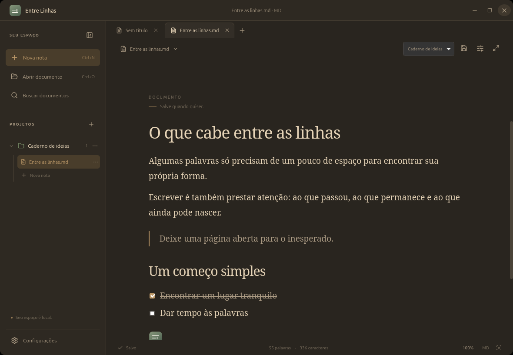
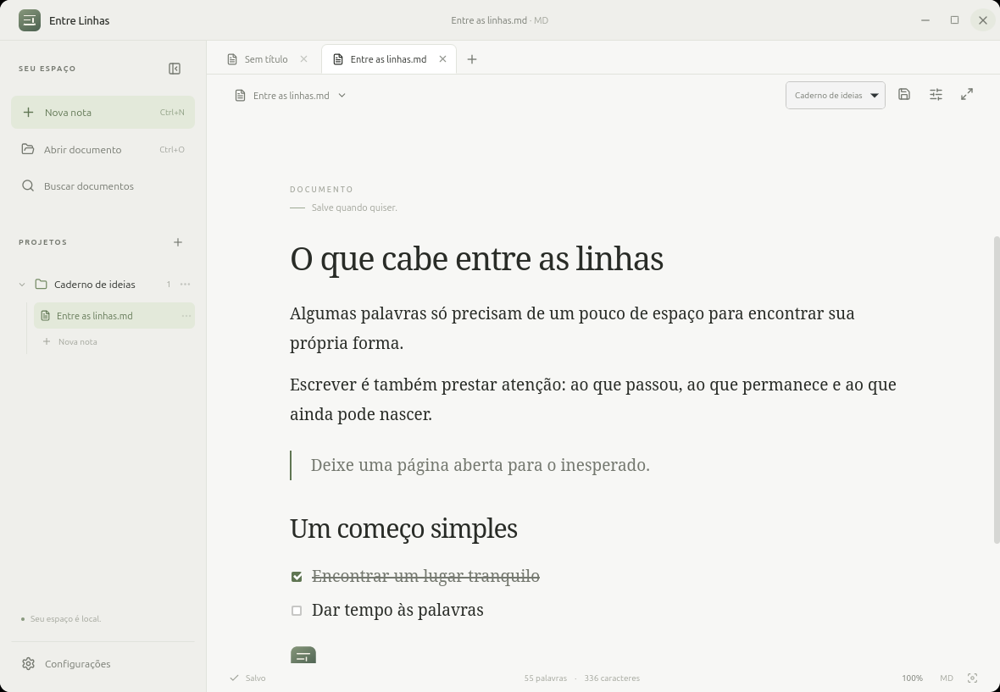
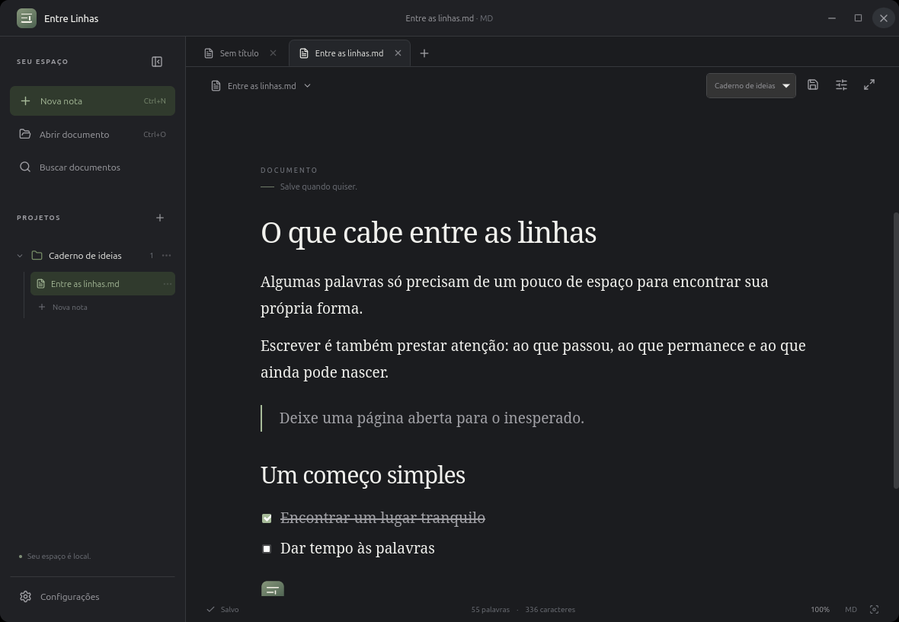

# Entre Linhas

**Um espaço tranquilo para escrever.**

Entre Linhas é um editor **desktop de verdade**, feito com Tauri 2, React e TypeScript para Ubuntu. Ao começar a digitar, a interface desaparece. Restam o texto, o fundo e o cursor. Esc traz os controles de volta, sem deslocar o texto.



## Suas palavras, no seu tempo

- Inicialização sempre em uma nota nova, vazia e mantida em memória.
- **Nenhum salvamento automático, recuperação de rascunhos ou restauração de abas.**
- Salvamento manual em arquivos Markdown e TXT comuns, em qualquer pasta.
- Projetos lógicos com nome, cor, ícone opcional e referências a documentos externos.
- Abas reordenáveis; conteúdo, seleção e histórico de edição mantidos ao alternar entre elas.
- Interface imersiva automática, alternância manual, acesso por Esc e aproximação das bordas.
- Três temas: Claro, Escuro e Sépia Noturno.
- Cursor em bloco, fino ou invisível; fonte, tamanho, largura, zoom e entrelinha configuráveis.
- Navegação à esquerda ou à direita, redimensionável; abas superiores ou laterais.
- Busca e substituição no documento; busca por nome e conteúdo nos arquivos salvos registrados.
- Funcionamento local e offline, sem conta, servidor ou sincronização obrigatória.

## Salvamento e privacidade

**Ctrl+S é uma decisão sua.** Um rascunho não é escrito em SQLite, localStorage, arquivos de sessão ou mecanismos de recuperação. Ao fechar sem salvar, ele é descartado. Alterações em arquivos existentes também dependem de salvamento manual.

A confirmação antes de descartar vem **desativada**, como preferência inicial. É possível ativá-la em **Configurações → Comportamento**. Nesse caso, as opções são salvar, descartar ou cancelar. Uma gravação manual já solicitada termina antes de a janela fechar.

O SQLite armazena somente projetos, referências a arquivos e preferências. Uma nota nova pode ter um projeto escolhido, mas sua associação só se torna persistente depois de salvar. Remover uma associação ou excluir um projeto **preserva os arquivos físicos**. Arquivos movidos podem ser localizados novamente pelo seletor do sistema.

As gravações usam arquivo temporário na pasta de destino, sincronização e renomeação atômica. Esses temporários existem apenas durante uma ação explícita de salvar. O aplicativo verifica o conteúdo do arquivo com SHA-256 para detectar alterações externas e pede uma decisão antes de substituir. Arquivos somente leitura, caminhos ausentes, permissões e codificações incompatíveis geram erros visíveis.

## Editor e formatos

O editor usa TipTap/ProseMirror, com desfazer/refazer, composição de texto, Unicode e quebra automática de linhas. A barra de ferramentas fica disponível pelo botão de ajustes no documento ou pela seleção de texto.

Suporta negrito, itálico, sublinhado, tachado, títulos, listas, checklists interativas, citações, código, links, separadores, alinhamento, destaque, cores, tamanho de texto, imagens e tabelas com edição de linhas e colunas.

O formato inicial é `.md`. Altere para `.txt` em **Configurações → Arquivos**. O seletor **Salvar como** também permite escolher o formato para cada arquivo.

- **Markdown:** títulos, listas, links, código e demais elementos comuns usam sintaxe Markdown. Cor, tamanho, sublinhado, alinhamento, tabelas e tarefas utilizam HTML compatível dentro do Markdown quando necessário para manter a formatação reversível.
- **TXT:** contém somente texto UTF-8. Antes de exportar conteúdo formatado, o aplicativo avisa sobre a perda de formatação e imagens. O editor aberto mantém a versão rica até ser fechado.
- Arquivos `.markdown` também podem ser abertos. Arquivos em outras codificações devem ser convertidos para UTF-8 antes da abertura.

### Imagens

Insira pelo botão de imagem, arrastando um arquivo para o editor ou colando uma imagem da área de transferência quando o sistema a disponibilizar. As imagens são redimensionáveis pelos cantos.

Rascunhos mantêm as imagens **apenas em memória**. Ao salvar `Minha nota.md`, os recursos ficam em `Minha nota.assets/`, ao lado do arquivo, com referências relativas e nomes derivados do conteúdo. Ao usar **Salvar como**, as imagens carregadas são copiadas para os recursos do novo documento. Ao mover um Markdown, leve também a pasta de recursos.

Formatos: PNG, JPEG, GIF, WebP, AVIF e BMP. Imagens remotas não são baixadas automaticamente. Imagens indisponíveis geram aviso; referências são preservadas. Recursos de documentos já salvos não são apagados automaticamente quando deixam de ser usados.

## Temas

As capturas abaixo são da janela Tauri real, executada no Ubuntu 26.10 com Wayland. O texto apresentado foi criado somente para os testes e não acompanha a inicialização do aplicativo.

| Claro                                | Escuro                               | Sépia Noturno                                |
| ------------------------------------ | ------------------------------------ | -------------------------------------------- |
|  |  |  |

[Ver o modo imersivo](docs/screenshots/imersivo.png).

Os seletores nativos acompanham o modo claro ou escuro do aplicativo; Sépia Noturno usa a variante escura do GTK.

O cursor em bloco usa as coordenadas reais da seleção do ProseMirror e a largura do próximo grafema. Durante composição IME, a camada visual cede ao cursor nativo. Preferências de movimento reduzido são respeitadas.

## Instalação no Ubuntu

O projeto foi compilado e verificado no **Ubuntu 26.10, x86_64, GNOME/Wayland**. Não há Electron ou Chromium embutido: a interface usa o WebKitGTK do sistema.

### Pacote Debian

[Baixe o instalador e os checksums da versão 0.1.0](https://github.com/Bit-Devy/entrelinhas/releases/tag/v0.1.0).

Para instalar um pacote compilado localmente:

```bash
sudo apt install ./src-tauri/target/release/bundle/deb/*.deb
```

O aplicativo aparece no menu como **Entre Linhas**, com ícone próprio. O pacote depende do WebKitGTK 4.1 e GTK 3 do sistema. Uma compilação feita no Ubuntu 26.10 não garante compatibilidade binária com versões anteriores do Ubuntu; para elas, compile no sistema de destino.

### Instalação local, sem sudo

Depois de compilar:

```bash
bash scripts/install-local.sh
```

Essa opção copia o executável para `~/.local/share/entrelinhas/bin/entrelinhas` e registra ícone e atalho em `~/.local/share/applications/entrelinhas.desktop`. Respeita `XDG_DATA_HOME` quando definido. É uma alternativa ao `.deb`; escolha um dos métodos para evitar entradas duplicadas no menu.

## Desenvolvimento

Requisitos: Node.js 22.12 ou superior, npm, Rust estável (pelo menos 1.90), compilador C/C++ e as bibliotecas de desenvolvimento do Tauri 2.

Confira os [pré-requisitos oficiais do Tauri para Linux](https://v2.tauri.app/start/prerequisites/). O script utiliza os pacotes indicados para Ubuntu:

```bash
bash scripts/install-deps-ubuntu.sh
source "$HOME/.cargo/env"
npm ci
npm run desktop
```

Bibliotecas instaladas pelo script:

```text
libwebkit2gtk-4.1-dev build-essential curl wget file
libxdo-dev libssl-dev libayatana-appindicator3-dev librsvg2-dev gh
```

`npm run desktop` inicia Vite e a janela Tauri juntos. `npm run dev` sozinho serve a interface para desenvolvimento, mas as operações nativas exigem a janela desktop. Não existe armazenamento simulado no navegador.

### Compilação

```bash
npm run build                         # TypeScript + interface de produção
CARGO_BUILD_JOBS=2 npm run package     # Executável otimizado e pacote .deb
```

Saídas: `src-tauri/target/release/entrelinhas` e `src-tauri/target/release/bundle/deb/`.

As versões exatas de dependências JavaScript e Rust ficam em `package-lock.json` e `src-tauri/Cargo.lock`. Use `npm ci` para reproduzir a instalação.

## Testes

```bash
npm run check
npm run test:rust
cargo clippy --manifest-path src-tauri/Cargo.toml --lib -- -D warnings
npm run format:check
cargo fmt --manifest-path src-tauri/Cargo.toml -- --check
```

Para executar os testes da janela real:

```bash
sudo apt install webkitgtk-webdriver python3-gi gir1.2-atspi-2.0
cargo install tauri-driver --locked
cargo build --manifest-path src-tauri/Cargo.toml -j 2
npm run dev
# Em outro terminal, com a sessão gráfica ativa:
npm run test:desktop
```

Se o WebKitWebDriver não estiver no PATH, defina `WEBKIT_WEBDRIVER=/caminho/para/WebKitWebDriver`. O teste cria sua própria instância de `tauri-driver`, diretório XDG, banco SQLite e arquivos temporários. O seletor nativo é operado por AT-SPI somente na instância isolada do teste. Nenhum arquivo pessoal é utilizado.

O mesmo roteiro pode validar a versão empacotada:

```bash
python3 scripts/test-desktop.py --binary src-tauri/target/release/entrelinhas
```

### Verificações realizadas

- **20 testes TypeScript:** notas, abas, descarte, preferências, atalhos, Markdown, formatação, TXT, Unicode, busca, imagens, gravação explícita, conflitos e espera de gravações em andamento.
- **6 testes Rust:** gravação atômica, conflitos, UTF-8, nomes internacionais, imagens relativas, arquivos somente leitura, recursos inválidos, projetos em Downloads, exclusão sem apagar documentos, localização e busca.
- **16 verificações desktop:** inicialização, ocultação sem deslocamento, Esc, descarte após reiniciar, Ctrl+S com seletor GNOME, associação externa, abas, busca/substituição, colagem de imagens, temas, cursores, persistência, layout, F11, conflitos, busca global, confirmação opcional e TXT.
- O roteiro desktop também passou no **executável otimizado de produção, com o Vite desligado**.
- Documento de **280 mil caracteres** carregado e editado no roteiro desktop. O tempo medido inclui definir o conteúdo e inserir texto; não representa um benchmark de latência por tecla.

As capturas e o relatório de cada execução ficam em `artifacts/`, ignorado pelo Git. Capturas verificadas dos temas estão em `docs/screenshots/`.

### Limites e validação manual

O limite de abertura é 64 MB por documento. Cada imagem aceita até 20 MB; um salvamento aceita até 128 MB de recursos. A busca global apresenta até 100 resultados e lê os arquivos no backend, fora da thread da interface. Não inclui rascunhos e não mantém um índice oculto de conteúdo.

Os testes verificam Unicode e o tratamento de eventos de composição. **Uma sessão interativa completa com candidatos de um IME japonês ainda exige validação manual**; eventos sintetizados não comprovam toda a experiência do método de entrada. O redimensionamento da janela utiliza as APIs nativas do Tauri, sem tentar controlar painéis ou decorações do GNOME.

## Atalhos

| Ação                                | Atalho padrão                   |
| ----------------------------------- | ------------------------------- |
| Nova nota                           | Ctrl+N                          |
| Abrir documento                     | Ctrl+O                          |
| Salvar                              | Ctrl+S                          |
| Salvar como                         | Ctrl+Shift+S                    |
| Fechar aba                          | Ctrl+W                          |
| Próxima / anterior aba              | Ctrl+Tab / Ctrl+Shift+Tab       |
| Pesquisar / substituir              | Ctrl+F / Ctrl+H                 |
| Negrito / itálico / sublinhado      | Ctrl+B / Ctrl+I / Ctrl+U        |
| Desfazer / refazer                  | Ctrl+Z / Ctrl+Shift+Z           |
| Modo imersivo                       | Ctrl+Shift+F                    |
| Revelar interface                   | Esc                             |
| Menu do documento                   | Alt+F; setas para navegar       |
| Tela cheia                          | F11                             |
| Aumentar / reduzir / restaurar zoom | Ctrl+Plus / Ctrl+Minus / Ctrl+0 |

Os atalhos principais podem ser personalizados em **Configurações → Atalhos**, com verificação de combinações já utilizadas.

## Estrutura

```text
src/
  components/     navegação, projetos, ferramentas, busca e configurações
  core/           modelos, criação de notas, preferências e atalhos
  documents/      abertura, salvamento manual e confirmação de descarte
  editor/         TipTap, Markdown, pesquisa, imagens e cursor
  native/         comunicação com o backend e redimensionamento da janela
  test/           ambiente dos testes
  App.tsx         composição da janela e coordenação do estado em memória
  styles.css      identidade visual e os três temas
src-tauri/
  src/files.rs    leitura UTF-8, conflitos, escrita atômica e recursos
  src/database.rs projetos, referências e preferências em SQLite
  src/models.rs   tipos compartilhados pelos comandos nativos
  src/lib.rs      comandos assíncronos, executados em workers
  capabilities/   permissões da janela e seletores
  icons/          formatos do ícone para empacotamento
assets/icon.svg   desenho original do ícone
scripts/          preparação, instalação local e teste desktop
```

Em uma instalação normal, o SQLite fica em `$XDG_DATA_HOME/io.github.bitdevy.entrelinhas/library.sqlite3` — normalmente `~/.local/share/io.github.bitdevy.entrelinhas/library.sqlite3`. O código-fonte não recebe dados pessoais.

Repositório: [Bit-Devy/entrelinhas](https://github.com/Bit-Devy/entrelinhas). Desenvolvimento incremental diretamente na `main`, com commits `uN - descrição curta`.

Licença [MIT](LICENSE).
